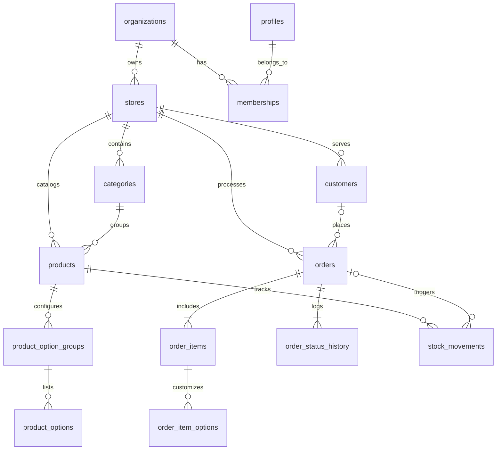

# BENIT — Database Schema Specification

## 1. Core Database Principles

1. **Primary Keys:** All tables use `UUID` (`gen_random_uuid()`) as primary keys.
2. **Monetary Precision:** All monetary values are stored in **integer minor units (`_cents`, `INTEGER`)** (e.g., R$ 25,90 = `2590`). Floating-point types (`FLOAT`, `REAL`) are strictly forbidden.
3. **Timestamps:** Every table includes `created_at TIMESTAMPTZ NOT NULL DEFAULT now()` and, where mutable, `updated_at TIMESTAMPTZ NOT NULL DEFAULT now()` maintained via trigger.
4. **Tenant Isolation:** Every operational table carries `store_id UUID NOT NULL REFERENCES stores(id) ON DELETE CASCADE` and is indexed on `store_id`.
5. **Historical Immutability:** `order_items` and `order_item_options` store snapshots of names and prices at the exact moment of purchase.

---

## 2. Entity-Relationship Diagram

---

## 3. Table Definitions

### 3.1. `profiles`
Linked 1:1 with `auth.users`.
- `id` (`UUID`, PK, references `auth.users(id) ON DELETE CASCADE`)
- `full_name` (`TEXT NOT NULL`)
- `email` (`TEXT NOT NULL`)
- `phone` (`TEXT`)
- `is_platform_admin` (`BOOLEAN NOT NULL DEFAULT false`) — strictly separated from tenant roles
- `created_at`, `updated_at` (`TIMESTAMPTZ`)

### 3.2. `organizations`
- `id` (`UUID`, PK)
- `name` (`TEXT NOT NULL`)
- `slug` (`TEXT NOT NULL UNIQUE`)
- `document_number` (`TEXT`) — optional CNPJ/CPF
- `created_by` (`UUID NOT NULL REFERENCES profiles(id)`)
- `created_at`, `updated_at` (`TIMESTAMPTZ`)

### 3.3. `memberships`
Links users to organizations (and optionally specific stores) with role-based access.
- `id` (`UUID`, PK)
- `organization_id` (`UUID NOT NULL REFERENCES organizations(id) ON DELETE CASCADE`)
- `user_id` (`UUID NOT NULL REFERENCES profiles(id) ON DELETE CASCADE`)
- `role` (`membership_role NOT NULL DEFAULT 'OWNER'`) — Enum: `OWNER`, `MANAGER`, `ATTENDANT`, `KITCHEN`
- `created_at`, `updated_at` (`TIMESTAMPTZ`)
- `UNIQUE (organization_id, user_id)`

### 3.4. `stores`
- `id` (`UUID`, PK)
- `organization_id` (`UUID NOT NULL REFERENCES organizations(id) ON DELETE CASCADE`)
- `name` (`TEXT NOT NULL`)
- `slug` (`TEXT NOT NULL UNIQUE`) — used for `/menu/[slug]`
- `description` (`TEXT`)
- `logo_url` (`TEXT`)
- `banner_url` (`TEXT`)
- `phone` (`TEXT`)
- `whatsapp` (`TEXT`)
- `address` (`TEXT`)
- `currency` (`TEXT NOT NULL DEFAULT 'BRL'`)
- `is_open` (`BOOLEAN NOT NULL DEFAULT true`)
- `is_published` (`BOOLEAN NOT NULL DEFAULT false`)
- `last_order_number` (`INTEGER NOT NULL DEFAULT 0`) — atomic counter per store
- `created_at`, `updated_at` (`TIMESTAMPTZ`)

### 3.5. `categories`
- `id` (`UUID`, PK)
- `store_id` (`UUID NOT NULL REFERENCES stores(id) ON DELETE CASCADE`)
- `name` (`TEXT NOT NULL`)
- `description` (`TEXT`)
- `sort_order` (`INTEGER NOT NULL DEFAULT 0`)
- `is_active` (`BOOLEAN NOT NULL DEFAULT true`)
- `created_at`, `updated_at` (`TIMESTAMPTZ`)

### 3.6. `products`
- `id` (`UUID`, PK)
- `store_id` (`UUID NOT NULL REFERENCES stores(id) ON DELETE CASCADE`)
- `category_id` (`UUID REFERENCES categories(id) ON DELETE SET NULL`)
- `sku` (`TEXT`)
- `name` (`TEXT NOT NULL`)
- `description` (`TEXT`)
- `price_cents` (`INTEGER NOT NULL CHECK (price_cents >= 0)`)
- `image_url` (`TEXT`)
- `is_available` (`BOOLEAN NOT NULL DEFAULT true`)
- `is_archived` (`BOOLEAN NOT NULL DEFAULT false`) — soft delete to preserve FK references if desired
- `track_stock` (`BOOLEAN NOT NULL DEFAULT true`)
- `stock_quantity` (`INTEGER NOT NULL DEFAULT 0 CHECK (stock_quantity >= 0)`)
- `low_stock_threshold` (`INTEGER NOT NULL DEFAULT 5 CHECK (low_stock_threshold >= 0)`)
- `sort_order` (`INTEGER NOT NULL DEFAULT 0`)
- `created_at`, `updated_at` (`TIMESTAMPTZ`)

### 3.7. `product_option_groups` & `product_options`
Supports structured add-ons and variations (e.g., "Ponto da Carne", "Adicionais").
- **`product_option_groups`**:
  - `id` (`UUID`, PK)
  - `store_id` (`UUID NOT NULL REFERENCES stores(id) ON DELETE CASCADE`)
  - `product_id` (`UUID NOT NULL REFERENCES products(id) ON DELETE CASCADE`)
  - `name` (`TEXT NOT NULL`)
  - `min_select` (`INTEGER NOT NULL DEFAULT 0 CHECK (min_select >= 0)`)
  - `max_select` (`INTEGER NOT NULL DEFAULT 1 CHECK (max_select >= 1)`)
  - `is_required` (`BOOLEAN NOT NULL DEFAULT false`)
  - `sort_order` (`INTEGER NOT NULL DEFAULT 0`)
- **`product_options`**:
  - `id` (`UUID`, PK)
  - `store_id` (`UUID NOT NULL REFERENCES stores(id) ON DELETE CASCADE`)
  - `group_id` (`UUID NOT NULL REFERENCES product_option_groups(id) ON DELETE CASCADE`)
  - `name` (`TEXT NOT NULL`)
  - `price_cents` (`INTEGER NOT NULL DEFAULT 0 CHECK (price_cents >= 0)`)
  - `is_available` (`BOOLEAN NOT NULL DEFAULT true`)
  - `sort_order` (`INTEGER NOT NULL DEFAULT 0`)

### 3.8. `customers`
- `id` (`UUID`, PK)
- `store_id` (`UUID NOT NULL REFERENCES stores(id) ON DELETE CASCADE`)
- `name` (`TEXT NOT NULL`)
- `phone` (`TEXT NOT NULL`) — normalized digits for deduplication per store
- `email` (`TEXT`)
- `notes` (`TEXT`)
- `total_orders` (`INTEGER NOT NULL DEFAULT 0`)
- `total_spent_cents` (`INTEGER NOT NULL DEFAULT 0`)
- `last_order_at` (`TIMESTAMPTZ`)
- `created_at`, `updated_at` (`TIMESTAMPTZ`)
- `UNIQUE (store_id, phone)`

### 3.9. `orders`
- `id` (`UUID`, PK)
- `store_id` (`UUID NOT NULL REFERENCES stores(id) ON DELETE CASCADE`)
- `customer_id` (`UUID REFERENCES customers(id) ON DELETE SET NULL`)
- `order_number` (`INTEGER NOT NULL`)
- `source` (`order_source NOT NULL`) — Enum: `DIGITAL_MENU`, `MANUAL`
- `fulfillment_type` (`fulfillment_type NOT NULL DEFAULT 'PICKUP'`) — Enum: `DINE_IN`, `PICKUP`, `DELIVERY`
- `table_or_reference` (`TEXT`) — e.g., "Mesa 4" or delivery reference (as seen in reference UI)
- `status` (`order_status NOT NULL DEFAULT 'NEW'`) — Enum: `NEW`, `CONFIRMED`, `PREPARING`, `READY`, `COMPLETED`, `CANCELLED`
- `customer_name_snapshot` (`TEXT NOT NULL`)
- `customer_phone_snapshot` (`TEXT NOT NULL`)
- `subtotal_cents` (`INTEGER NOT NULL CHECK (subtotal_cents >= 0)`)
- `discount_cents` (`INTEGER NOT NULL DEFAULT 0 CHECK (discount_cents >= 0)`)
- `fee_cents` (`INTEGER NOT NULL DEFAULT 0 CHECK (fee_cents >= 0)`)
- `total_cents` (`INTEGER NOT NULL CHECK (total_cents >= 0)`)
- `notes` (`TEXT`)
- `stock_deducted` (`BOOLEAN NOT NULL DEFAULT false`) — idempotency flag for order stock state
- `idempotency_key` (`TEXT`) — prevents duplicate order creation on network retries
- `created_by` (`UUID REFERENCES profiles(id) ON DELETE SET NULL`)
- `created_at`, `updated_at` (`TIMESTAMPTZ`)
- `UNIQUE (store_id, order_number)`
- `UNIQUE (store_id, idempotency_key)`

### 3.10. `order_items` & `order_item_options`
- **`order_items`**:
  - `id` (`UUID`, PK)
  - `store_id` (`UUID NOT NULL REFERENCES stores(id) ON DELETE CASCADE`)
  - `order_id` (`UUID NOT NULL REFERENCES orders(id) ON DELETE CASCADE`)
  - `product_id` (`UUID REFERENCES products(id) ON DELETE SET NULL`)
  - `product_name_snapshot` (`TEXT NOT NULL`)
  - `unit_price_cents` (`INTEGER NOT NULL CHECK (unit_price_cents >= 0)`) — base product price snapshot
  - `options_unit_price_cents` (`INTEGER NOT NULL DEFAULT 0 CHECK (options_unit_price_cents >= 0)`)
  - `quantity` (`INTEGER NOT NULL CHECK (quantity > 0)`)
  - `total_item_cents` (`INTEGER NOT NULL CHECK (total_item_cents >= 0)`)
  - `notes` (`TEXT`)
- **`order_item_options`**:
  - `id` (`UUID`, PK)
  - `order_item_id` (`UUID NOT NULL REFERENCES order_items(id) ON DELETE CASCADE`)
  - `option_id` (`UUID REFERENCES product_options(id) ON DELETE SET NULL`)
  - `group_name_snapshot` (`TEXT NOT NULL`)
  - `option_name_snapshot` (`TEXT NOT NULL`)
  - `price_cents` (`INTEGER NOT NULL CHECK (price_cents >= 0)`)

### 3.11. `order_status_history`
- `id` (`UUID`, PK)
- `store_id` (`UUID NOT NULL REFERENCES stores(id) ON DELETE CASCADE`)
- `order_id` (`UUID NOT NULL REFERENCES orders(id) ON DELETE CASCADE`)
- `from_status` (`order_status`)
- `to_status` (`order_status NOT NULL`)
- `reason` (`TEXT`)
- `changed_by` (`UUID REFERENCES profiles(id) ON DELETE SET NULL`)
- `created_at` (`TIMESTAMPTZ NOT NULL DEFAULT now()`)

### 3.12. `stock_movements`
- `id` (`UUID`, PK)
- `store_id` (`UUID NOT NULL REFERENCES stores(id) ON DELETE CASCADE`)
- `product_id` (`UUID NOT NULL REFERENCES products(id) ON DELETE CASCADE`)
- `order_id` (`UUID REFERENCES orders(id) ON DELETE SET NULL`)
- `movement_type` (`stock_movement_type NOT NULL`) — Enum: `INITIAL`, `ENTRY`, `EXIT`, `ADJUSTMENT`, `ORDER_DEDUCTION`, `ORDER_REVERSAL`
- `quantity_delta` (`INTEGER NOT NULL CHECK (quantity_delta <> 0)`) — positive for additions/reversals, negative for deductions/exits
- `previous_quantity` (`INTEGER NOT NULL CHECK (previous_quantity >= 0)`)
- `new_quantity` (`INTEGER NOT NULL CHECK (new_quantity >= 0)`)
- `reference_key` (`TEXT UNIQUE`) — e.g., `order:<order_id>:deduct` or `order:<order_id>:reverse` for strict idempotency
- `reason` (`TEXT`)
- `created_by` (`UUID REFERENCES profiles(id) ON DELETE SET NULL`)
- `created_at` (`TIMESTAMPTZ NOT NULL DEFAULT now()`)

