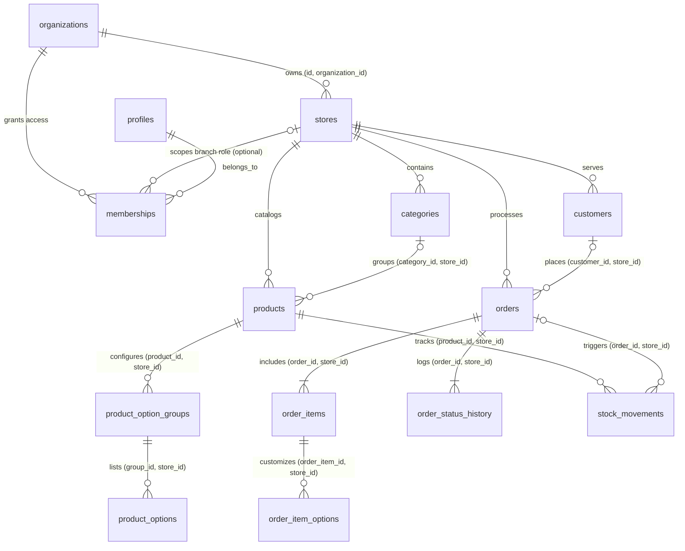

# BENIT — Database Schema Specification

## 1. Core Database Principles

1. **Primary Keys:** All tables use `UUID` (`gen_random_uuid()`) as primary keys.
2. **Monetary Precision:** All monetary values are stored in **integer minor units (`_cents`, `INTEGER`)** (e.g., R$ 25,90 = `2590`). Floating-point types (`FLOAT`, `REAL`) are strictly forbidden.
3. **Composite Tenant Foreign Keys:** Every parent operational entity exposes `UNIQUE (id, store_id)` (and `stores` exposes `UNIQUE (id, organization_id)`). Child tables enforce composite foreign keys (`FOREIGN KEY (parent_id, store_id) REFERENCES parent(id, store_id)`), preventing cross-tenant references at the database engine level.
4. **Multi-Store & SaaS Plan Readiness:**
   - `organizations` includes `plan_tier`, `subscription_status`, and `max_stores`.
   - `memberships` supports both organization-wide roles (`store_id IS NULL`, e.g., `OWNER`) and unit-scoped roles (`store_id IS NOT NULL`, e.g., branch `MANAGER`, `ATTENDANT`, `KITCHEN`).
5. **Historical Immutability:** `order_items` and `order_item_options` store immutable snapshots of product/option names and prices at order creation.

---

## 2. Entity-Relationship Diagram

---

## 3. Table Summary

- **`profiles`**: `id` (FK `auth.users`), `full_name`, `email`, `phone`, `is_platform_admin`, timestamps.
- **`organizations`**: `id`, `name`, `slug` (unique), `document_number`, `plan_tier` (`'FREE_PILOT'`), `subscription_status` (`'ACTIVE'`), `max_stores` (`>= 1`), `created_by`, timestamps.
- **`stores`**: `id`, `organization_id`, `name`, `slug` (unique), `description`, `logo_url`, `banner_url`, `phone`, `whatsapp`, `address`, `currency` (`'BRL'`), `is_open`, `is_published`, `last_order_number`, `UNIQUE (id, organization_id)`.
- **`memberships`**: `id`, `organization_id`, `store_id` (nullable FK `(store_id, organization_id)` -> `stores(id, organization_id)`), `user_id`, `role` (`OWNER`, `MANAGER`, `ATTENDANT`, `KITCHEN`), partial unique indexes for org-wide and store-scoped memberships.
- **`categories`**: `id`, `store_id`, `name`, `description`, `sort_order`, `is_active`, `UNIQUE (id, store_id)`.
- **`products`**: `id`, `store_id`, `category_id`, `sku`, `name`, `description`, `price_cents`, `image_url`, `is_available`, `is_archived`, `track_stock`, `stock_quantity`, `low_stock_threshold`, `sort_order`, composite FK `(category_id, store_id)`.
- **`product_option_groups` & `product_options`**: Enforces `min_select >= 0`, `max_select >= GREATEST(1, min_select)`, `is_required`, `price_cents >= 0`, with composite tenant FKs.
- **`customers`**: `id`, `store_id`, `name`, `phone`, `email`, `notes`, `total_orders`, `total_spent_cents`, `last_order_at`, `UNIQUE (store_id, phone)`.
- **`orders`**: `id`, `store_id`, `customer_id`, `order_number`, `source` (`DIGITAL_MENU`, `MANUAL`), `fulfillment_type` (`DINE_IN`, `PICKUP`, `DELIVERY`), `table_or_reference`, `status`, customer snapshots, `subtotal_cents`, `discount_cents`, `fee_cents`, `total_cents`, `notes`, `stock_deducted`, `idempotency_key`, `UNIQUE (store_id, order_number)`, `UNIQUE (store_id, idempotency_key)`.
- **`order_items` & `order_item_options`**: Immutable snapshots (`product_name_snapshot`, `unit_price_cents`, `options_unit_price_cents`, `total_item_cents`, `group_name_snapshot`, `option_name_snapshot`, `price_cents`) with composite tenant FKs.
- **`order_status_history`**: Audit log of every status transition (`from_status`, `to_status`, `reason`, `changed_by`, `created_at`).
- **`stock_movements`**: Immutable ledger (`INITIAL`, `ENTRY`, `EXIT`, `ADJUSTMENT`, `ORDER_DEDUCTION`, `ORDER_REVERSAL`) with `quantity_delta`, `previous_quantity`, `new_quantity`, `reference_key` (`UNIQUE`), `reason`, `created_by`.

## 4. Checkout & Payments Extension (0004–0007)

| Table / change | Purpose | Access |
|---|---|---|
| `order_status` + `AWAITING_PAYMENT` | Online orders before approval | — |
| `stores` + timezone, min order, fulfillment flags, offline methods, pix key, online flag, payment window, ETA | Checkout configuration | members read; OWNER/MANAGER write (trigger) |
| `store_business_hours` | Weekly slots (overnight allowed) | members read; managers write |
| `delivery_zones` | Neighborhood groups with fee/min/ETA (normalized array + GIN index) | members read; managers write |
| `coupons`, `coupon_redemptions` | Discounts and usage ledger | coupons: managers write; redemptions: read-only, RPC writes |
| `orders` + payment_method/status, expires/paid at, public_token, delivery_address, zone, coupon, eta, counted_in_stats | Payment and delivery state | protected columns: RPC only |
| `payments` | One row per provider payment (Pix QR, status, amounts) | members read; RPC writes |
| `store_payment_accounts` | Encrypted Mercado Pago OAuth tokens | service role only |
| `oauth_states`, `webhook_events` | OAuth CSRF/PKCE, webhook dedupe | service role only |

Key RPCs: `quote_checkout` (anon, preview), `create_order_atomic` (16 args), `transition_order_status_atomic`, `apply_payment_update` (service), `expire_unpaid_orders` (service), `get_public_order_by_token` (anon), `get_public_menu_by_slug` (now also returns hours, zones, accepted methods, MP public key).
